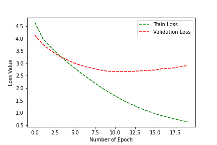

# Seq2seq LSTM for disfluent question repair

Turning a disfluent spoken-style question into the clean question the speaker meant, using an LSTM encoder–decoder trained on Google's [Disfl-QA](https://github.com/google-research-datasets/disfl-qa) dataset.

| Disfluent input | Intended question |
|---|---|
| in what country is norse found **no wait normandy not norse**? | in what country is normandy located? |
| from which **norse leader i mean** countries did the norse originate? | from which countries did the norse originate? |
| **when i mean** who was the norse leader? | who was the norse leader? |

People correct themselves mid-sentence ("no wait", "I mean"). Voice assistants and search systems that take speech have to recover the intended question before they can answer it.

## Approach

- **Tokenisation:** SentencePiece unigram models with a 1,000-token vocabulary, trained separately on the disfluent and the clean questions, with punctuation kept as its own symbols.
- **Model** (`encdecmod.py`): a 4-layer **bidirectional LSTM encoder** whose final states are projected down and passed to a 4-layer LSTM decoder. 256-dimensional embeddings and hidden states, dropout 0.1.
- **Training** (`train_test.ipynb`): AdamW (learning rate 1e-3), batch size 8, mixed precision, cross-entropy on next-token prediction (padding ignored), early stopping on validation loss.
- **Data:** Disfl-QA's train, dev and test splits (7,182 / 1,000 / 3,643 questions).

## Results



Validation loss bottoms out around epoch 10 while training loss keeps falling, so the model starts overfitting after that.

Scores on the 3,643 test questions, computed from the saved predictions in `Output/`:

| | BLEU-1 | BLEU-2 | BLEU-4 | Exact match |
|---|---|---|---|---|
| This model | 32.5 | 20.3 | 8.0 | 1 |
| Baseline: copy the disfluent input unchanged | 65.4 | 61.6 | 53.9 | 0 |

**What this shows:** the model learned the *shape* of a clean question (short, well-formed, starts with a question word) but not to carry over the right content words. For example, for "in what country is norse found no wait normandy not norse?" it produced "in what country is an unwolvely?". A plain encoder–decoder has to squeeze the whole question into one fixed-size state, which loses rare words like names, and the small subword vocabulary makes it easy to generate plausible-looking non-words.

**What would improve it:**
- Add **attention**, or a **copy/pointer mechanism**, so the decoder can copy words straight from the input. Most of the clean question appears in the disfluent one.
- Use a **pretrained transformer** such as T5. The Disfl-QA paper reports much stronger results this way.
- Stop at the best validation epoch, and use a larger vocabulary.

This was a learning project in sequence-to-sequence modelling. The value is in the end-to-end pipeline and the analysis of why a plain LSTM falls short here.

## Repository layout

| Path | Contents |
|---|---|
| `train_test.ipynb` | Vocabulary building, training, testing and BLEU evaluation |
| `encdecmod.py` | Embedding, LSTM encoder/decoder and early-stopping classes |
| `disfdata.py` | PyTorch dataset that tokenises and pads question pairs |
| `extrastuff.py` | Training, testing, checkpoint save/load helpers |
| `Datasets/Disfl-QA/` | The dataset and the trained SentencePiece models |
| `Output/` | Test-set inputs, model predictions and targets, one per line |
| `Results/` | Loss curve |

## Running it

Needs Python 3.8+ and a CUDA GPU (the notebook calls `.cuda()`).

```bash
pip install -r requirements.txt
jupyter notebook train_test.ipynb
```

Run the cells in order. Checkpoints are written to `Model/`, which is not committed.

## Credits

- **Dataset:** Disfl-QA, Gupta, Aditya et al., *Disfl-QA: A Benchmark Dataset for Understanding Disfluencies in Question Answering*, Findings of ACL 2021. From [google-research-datasets/disfl-qa](https://github.com/google-research-datasets/disfl-qa), released under [CC BY 4.0](https://creativecommons.org/licenses/by/4.0/). It's built on SQuAD 2.0 questions.
- **Code:** `encdecmod.py`, `disfdata.py` and `extrastuff.py` are adapted from [hoang-tn-nguyen/Disfl-QA-Performer](https://github.com/hoang-tn-nguyen/Disfl-QA-Performer); those files say so at the top. The notebook, experiments and evaluation are my own.

Because parts of the code come from another project, this repository doesn't add its own licence over them. The dataset stays under CC BY 4.0.
